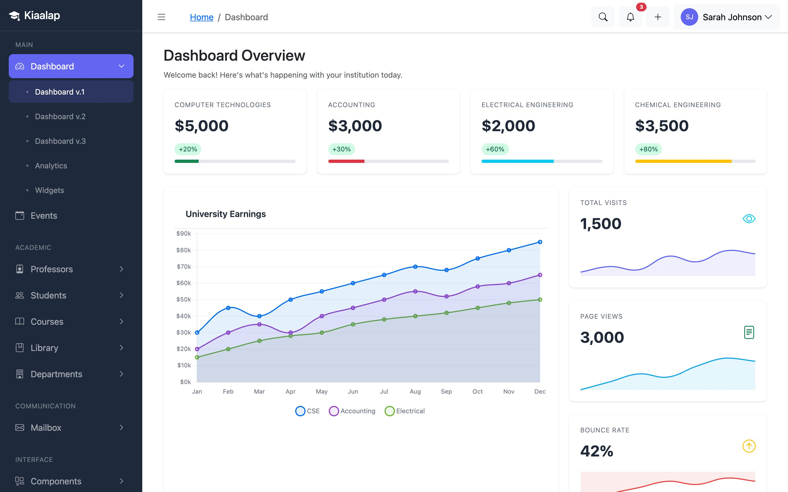
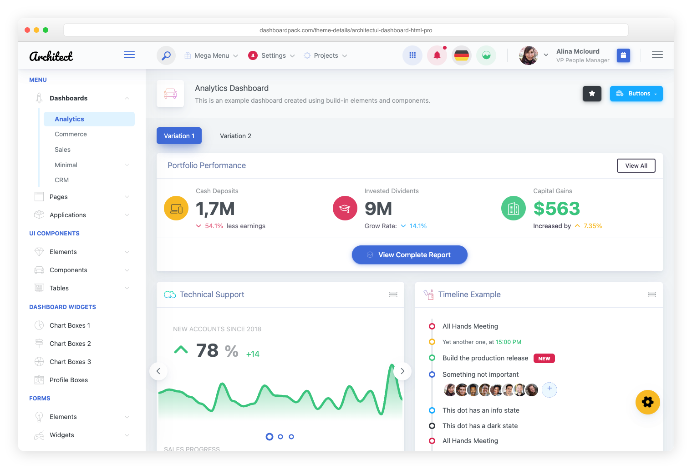
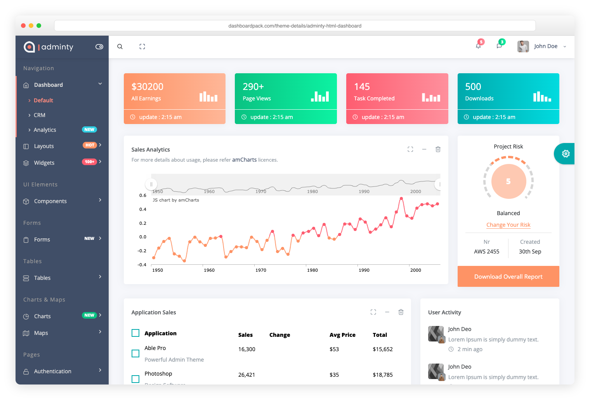
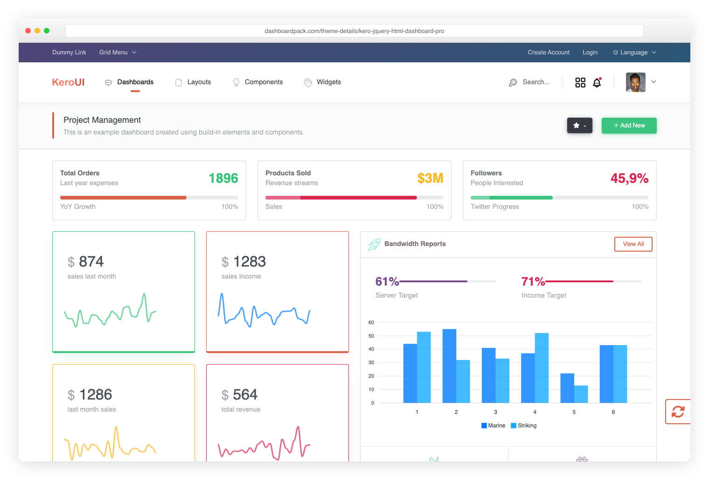

# Kiaalap — Bootstrap 5 Education Dashboard Template



Kiaalap is a free, MIT-licensed admin dashboard template for education projects. It includes 63 HTML pages, reusable Handlebars partials, Bootstrap components and vanilla JavaScript examples, with Vite for development and production builds.

The pages use demo data. Student and course screens, mailbox, payments and authentication are frontend examples; connect them to your own backend for persistence, authorization, email and payment processing.

[Live preview](https://colorlib.com/polygon/kiaalap/) · [Template website](https://kiaalap.colorlib.com/) · [Documentation](https://kiaalap.colorlib.com/docs/getting-started/) · [Release downloads](https://github.com/puikinsh/kiaalap/releases)

## What's included

- Three dashboard layouts, analytics and widgets.
- Student and professor lists, profiles, and add/edit forms.
- Course, department and library screens, including course-payment UI.
- Mailbox layouts and a FullCalendar event demo.
- Chart.js examples, searchable data tables, form controls and a Quill editor.
- Maps, image cropping, upload UI and other component demos.
- Login, registration, password recovery, lock screen and error pages.
- A minimal [starter page](starter.html) and a command to generate new pages.

JavaScript, stylesheets and icon fonts are bundled locally. Some demo images, avatars and map tiles use external services; replace those resources if you need a self-contained deployment. There is no jQuery dependency.

## Premium admin dashboard templates

Looking for more layouts, components or framework editions? Explore [DashboardPack's premium admin templates](https://dashboardpack.com/) and compare their live demos to find a starting point for your next project.

<table>
  <tr>
    <td width="50%" valign="top">
      <a href="https://dashboardpack.com/theme-details/admindek-html/">
        
      </a>
      <h3><a href="https://dashboardpack.com/theme-details/admindek-html/">Admindek HTML</a></h3>
      <p>Multiple dashboards, light and dark themes, and RTL layouts.</p>
      <p><a href="https://demo.dashboardpack.com/admindek-html/">Live preview</a> · <a href="https://dashboardpack.com/theme-details/admindek-html/"><strong>View template →</strong></a></p>
    </td>
    <td width="50%" valign="top">
      <a href="https://dashboardpack.com/theme-details/architectui-dashboard-html-pro/">
        
      </a>
      <h3><a href="https://dashboardpack.com/theme-details/architectui-dashboard-html-pro/">ArchitectUI HTML PRO</a></h3>
      <p>Configurable layouts, application pages and a live theme options panel.</p>
      <p><a href="https://demo.dashboardpack.com/architectui-html-pro/">Live preview</a> · <a href="https://dashboardpack.com/theme-details/architectui-dashboard-html-pro/"><strong>View template →</strong></a></p>
    </td>
  </tr>
  <tr>
    <td width="50%" valign="top">
      <a href="https://dashboardpack.com/theme-details/adminty-html-dashboard/">
        
      </a>
      <h3><a href="https://dashboardpack.com/theme-details/adminty-html-dashboard/">Adminty HTML</a></h3>
      <p>Vertical and horizontal navigation, forms and data-table examples.</p>
      <p><a href="https://demo.dashboardpack.com/adminty-html/pages/index.html">Live preview</a> · <a href="https://dashboardpack.com/theme-details/adminty-html-dashboard/"><strong>View template →</strong></a></p>
    </td>
    <td width="50%" valign="top">
      <a href="https://dashboardpack.com/theme-details/kero-jquery-html-dashboard-pro/">
        
      </a>
      <h3><a href="https://dashboardpack.com/theme-details/kero-jquery-html-dashboard-pro/">Kero HTML PRO</a></h3>
      <p>Sidebar and horizontal layouts, dashboard variations and jQuery components.</p>
      <p><a href="https://demo.dashboardpack.com/kero-html-sidebar-pro/">Live preview</a> · <a href="https://dashboardpack.com/theme-details/kero-jquery-html-dashboard-pro/"><strong>View template →</strong></a></p>
    </td>
  </tr>
</table>

[Browse all premium templates on DashboardPack →](https://dashboardpack.com/)

## Quick start

Use Node.js 24.8+ (recommended), or Node.js 22.22+ in the 22.x line, and npm 10+. The [.nvmrc](.nvmrc) file selects Node.js 24 for nvm users.

```bash
git clone https://github.com/puikinsh/kiaalap.git
cd kiaalap
npm ci
npm run dev
```

Vite opens the dashboard at `http://localhost:3000`. If that port is occupied, use the address printed in the terminal. Run the project through Vite so it can render Handlebars partials and process JavaScript and Sass.

To build and preview the production files:

```bash
npm run build
npm run preview
```

Deploy the contents of `dist/` to a static web server. Relative asset URLs support deployment at the domain root or in a subdirectory. See the [deployment guide](DEPLOYMENT_GUIDE.md) for validation, caching and server configuration.

## Project structure

```text
kiaalap/
├── *.html               # Page templates, including starter.html
├── src/
│   ├── config/          # Shared site data and page metadata
│   ├── css/             # Dashboard and custom styles
│   ├── scss/            # Bootstrap theme and Sass entry points
│   ├── js/              # Shared modules and lazy library loaders
│   ├── partials/        # Handlebars header, sidebar, footer and assets
│   └── helpers/         # Template helpers and HTML normalization
├── public/              # Static files copied into the build
├── scripts/             # Page generation, cleanup and stylesheet checks
├── tests/               # Unit, build and browser checks
├── vite.config.js       # Page discovery and build configuration
└── package.json         # Dependencies, scripts and Node.js requirements
```

## Customize the template

| Change                                                | File                                                 |
| ----------------------------------------------------- | ---------------------------------------------------- |
| Shared metadata, demo user and header notifications   | [src/config/site.js](src/config/site.js)             |
| Page titles, breadcrumbs and active navigation groups | [src/config/pages.js](src/config/pages.js)           |
| Sidebar links                                         | [src/partials/sidebar.hbs](src/partials/sidebar.hbs) |
| Shared header and footer                              | [src/partials](src/partials)                         |
| Bootstrap colors, font and border radius              | [src/scss/_theme.scss](src/scss/_theme.scss)         |
| Additional Bootstrap theme variables                  | [src/scss/main.scss](src/scss/main.scss)             |
| Dashboard colors, spacing and dimensions              | [src/css/dashboard.css](src/css/dashboard.css)       |

The header uses initials for the demo user by default. Set `user.avatar` in `src/config/site.js` to a local image URL to use a photo.

### Add a page

```bash
npm run page:new -- attendance
```

This copies `starter.html` to `attendance.html` and refuses to overwrite an existing file. Edit the page content, add a sidebar link and optionally add metadata in `src/config/pages.js`. Restart the development server after creating a page; Vite discovers root-level HTML pages automatically.

Use lowercase names with hyphens, such as `student-attendance`. Names containing `template` or `-new` are excluded from production builds and rejected by the generator.

### Load optional libraries

Chart.js is a separate entry included on pages containing a canvas or an inline Chart.js demo. Other optional libraries load on demand through [src/js/lazy.js](src/js/lazy.js), with their required styles.

These hooks initialize automatically on dashboard pages:

| HTML hook                    | Library    |
| ---------------------------- | ---------- |
| `.swiper`                    | Swiper     |
| `[data-simplebar]`           | SimpleBar  |
| `.tom-select`                | Tom Select |
| `.countup` with `data-count` | CountUp    |
| `[data-aos]`                 | AOS        |

In a dashboard page module, use the loader when you need to configure a library yourself:

```js
const Chart = await Kiaalap.load('chart');
const dayjs = await Kiaalap.load('dayjs');
const { Calendar, plugins } = await Kiaalap.load('fullcalendar');

// Initialize library hooks inside content you have added dynamically.
Kiaalap.initLazyLibraries(document.getElementById('main-content'));
```

Existing chart demos use `window.Chart`. Custom modules can import Chart.js directly or use the loader. For changes when upgrading from v3, see the [migration guide](https://kiaalap.colorlib.com/docs/migrating-from-v3/).

## Commands and checks

| Command                          | Purpose                                                        |
| -------------------------------- | -------------------------------------------------------------- |
| `npm run dev`                    | Start the development server                                   |
| `npm run build`                  | Generate production files in `dist/`                           |
| `npm run preview`                | Serve the production build locally                             |
| `npm run page:new -- attendance` | Generate a page from the starter                               |
| `npm run clean`                  | Remove the build directory                                     |
| `npm run lint:js`                | Lint JavaScript                                                |
| `npm run lint:css`               | Lint CSS, check SCSS formatting and compile Sass               |
| `npm run lint:html:built`        | Validate rendered HTML in `dist/`                              |
| `npm run format`                 | Format source files with Prettier                              |
| `npm test`                       | Run unit tests                                                 |
| `npm run test:build`             | Check built assets and the shared JavaScript size budget       |
| `npm run check`                  | Run linting, unit tests, build, rendered HTML and build checks |
| `npm run test:browser`           | Run the production browser suite                               |

CSS checks use ESLint's CSS plugin. SCSS checks use Prettier and Dart Sass; Stylelint-specific rules are not applied. Prefer `lint:html:built` for validation because source templates contain Handlebars expressions.

For browser checks, build first and install Playwright's Chromium once:

```bash
npm run check
npx playwright install chromium
npm run test:browser
```

The browser suite covers every built page and selected interactions in Chromium. It stubs external demo images and map tiles and does not test a backend. To use an installed Google Chrome, set `PLAYWRIGHT_CHANNEL=chrome`. Test your target browsers and accessibility requirements before shipping a customized application.

### Dependency maintenance

See [package.json](package.json) for dependency ranges and [package-lock.json](package-lock.json) for the exact installed versions. Use `npm ci` for reproducible installs and check current advisories with:

```bash
npm audit
npm audit --omit=dev
```

Quill is deliberately pinned to `2.0.2` because `2.0.3` is affected by an [HTML export XSS advisory](https://github.com/advisories/GHSA-v3m3-f69x-jf25). Review that advisory before changing the pin. Audit results can change as new advisories are published.

## Releases and contributions

See the [changelog](CHANGELOG.md) for release history and the [v4 release notes](release.md) for dependency, performance and migration details.

Report bugs or suggest improvements through [GitHub issues](https://github.com/puikinsh/kiaalap/issues). Include the page, steps to reproduce, browser and relevant console output. Run `npm run check` before submitting a code change, and run browser tests when changing page behavior.

## Explore AdminLTE

[AdminLTE](https://adminlte.io/) is another free, open-source Bootstrap admin dashboard template. Explore its reusable UI components, live preview and documentation for your next admin panel.

## More from Colorlib

Find more designs and resources for your next website:

- [Admin dashboard templates](https://colorlib.com/wp/free-bootstrap-admin-dashboard-templates/) — compare free and premium dashboard designs.
- [HTML website templates](https://colorlib.com/wp/templates/) — browse templates for business sites, portfolios, landing pages and more.
- [Bootstrap 5 templates](https://colorlib.com/wp/cat/bootstrap-5/) — explore website designs built with Bootstrap 5.
- [WordPress themes](https://colorlib.com/wp/themes/) — find themes for WordPress projects.
- [Colorlib blog](https://colorlib.com/wp/) — read web design articles, tutorials and template collections.

## License and credits

Created by [Colorlib](https://colorlib.com/). Kiaalap is distributed under the [MIT license](LICENSE); retain its copyright and permission notice in copies or substantial portions of the template. Bundled third-party libraries retain their own licenses.
